# Drug Simulator

> **循证治理的多药药代动力学 / 药效动力学机制模拟器**  
> **Evidence-Governed Mechanistic Simulator for Multi-Drug Pharmacokinetic and Pharmacodynamic Interactions**

---

## 1. 总体设计 / Overall Design

Drug Simulator 将药物联用问题拆分为一条可追踪、可复现的计算链：

Drug Simulator decomposes multi-drug interaction analysis into a traceable and reproducible computational pipeline:

```mermaid
flowchart LR
    A["生理基线<br/>Physiological Baseline"] --> B["给药方案<br/>Administration Regimen"]
    B --> C["时间-暴露模型<br/>Time & Exposure Model"]
    C --> D["PK / ADME 交互<br/>PK / ADME Interactions"]
    D --> E["有效暴露状态<br/>Effective Exposure State"]
    E --> F["PD / 靶点与通路<br/>PD / Targets & Pathways"]
    F --> G["生理终点<br/>Physiological Endpoints"]
    G --> H["效果与副作用<br/>Effects & Adverse Effects"]
    H --> I["单药 / 联用比较<br/>Mono / Combination Comparison"]
    I --> J["证据与不确定性<br/>Evidence & Uncertainty"]
```

系统不以“给药剂量”直接代表药物效应，而是将其转换为随时间变化的实际暴露，再传播至靶点、通路和生理终点。

The simulator never treats the administered dose as the final pharmacological effect. It first converts the regimen into time-dependent exposure, then propagates that exposure through targets, pathways, and physiological endpoints.

---

## 2. 阶段解耦 / Stage Decoupling

建议将系统进一步解耦。每个阶段只负责一种状态转换，并通过稳定的数据契约连接。

Further decoupling is recommended. Each stage should own one class of state transformation and communicate through stable contracts.

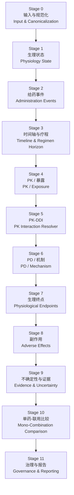

### Stage 0 — 输入与规范化 / Input & Canonicalization

**目的 / Purpose**

- 解析药物名称、化合物 ID、剂量单位、给药途径和制剂。
- Resolve compound identity, dose units, route, and formulation.
- 拒绝歧义名称和不完整的关键输入。
- Reject ambiguous compounds and materially incomplete inputs.
- 生成标准化、不可变的模拟请求。
- Produce a canonical immutable simulation request.

---

### Stage 1 — 生理状态 / Physiological State

**目的 / Purpose**

将用户提供的生理数据转换为 PK/PD 修正因子，而不是诊断标签。

Convert supplied physiological data into PK/PD modifiers rather than diagnostic labels.

可包括 / May include:

- 年龄 / age
- 体重、体成分 / weight and body composition
- 肾功能 / renal function
- 肝功能 / hepatic function
- 心血管基线 / cardiovascular baseline
- 代谢指标 / metabolic markers
- 可选药物基因组信息 / optional pharmacogenomics

输出 / Output:

```text
PhysiologicalState
├── clearance modifiers
├── volume/distribution modifiers
├── metabolic-capacity modifiers
├── protein-binding modifiers
├── pathway baseline states
└── uncertainty
```

---

### Stage 2 — 给药事件 / Administration Events

**目的 / Purpose**

将“药物 + 剂量 + 给药途径 + 制剂 + 时间表”转换为离散给药事件。

Convert compound + dose + route + formulation + schedule into explicit administration events.

```text
Regimen
  ↓
DoseEvent[]
```

支持 / Support:

- 口服 / oral
- IV bolus
- IV infusion
- SC
- IM
- transdermal
- 后续扩展局部、吸入、鼻腔等 / future local, inhaled, intranasal routes

---

## 3. 时间轴与疗程模型 / Timeline & Regimen-Horizon Model

时间必须成为一级输入，而不是 PK 模型中的附属参数。

Time must be a first-class input rather than a secondary PK parameter.

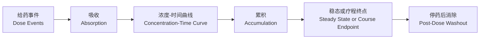

建议支持以下疗程模式：

Recommended regimen modes:

| 模式 / Mode | 目的 / Purpose |
|---|---|
| `single_dose` | 单次给药 / one-time exposure |
| `acute_course` | 短期有限疗程 / short finite course |
| `chronic_maintenance` | 长期稳定维持 / long-term maintenance |
| `loading_plus_maintenance` | 负荷量 + 维持量 / loading followed by maintenance |
| `intermittent` | 周期性或间歇给药 / intermittent dosing |
| `taper` | 逐步减量 / tapering |
| `prn_event_stream` | 按实际事件输入的按需给药 / event-defined PRN dosing |

“短期治愈”不作为引擎内部概念；引擎只描述有限疗程和其药理状态，不判断治疗是否实现“治愈”。

“Short-term cure” should not be an internal engine concept. The simulator models a finite course and its pharmacological state without asserting that the regimen achieves a cure.

---

## 4. 半衰期、累积与稳态 / Half-Life, Accumulation, and Steady State

对于长期或重复给药，稳态血药水平必须进入总设计线。

For repeated or long-term dosing, steady-state concentration must be part of the core architecture.

基本关系 / Core relationships:

```text
Ke = ln(2) / t1/2
```

其中 / where:

- `Ke`：消除速率常数 / elimination-rate constant
- `t1/2`：有效半衰期 / effective half-life

重复给药时需要联合考虑：

Repeated dosing must jointly consider:

```text
dose
route
bioavailability
formulation
dosing interval τ
half-life
clearance
distribution volume
active metabolites
enzyme/transporter interactions
physiological modifiers
```

输出不应只有单个“有效剂量”，而应至少包含：

Outputs should not collapse to a single “effective dose”; at minimum they should include:

```text
C(t)
Cmax
Tmax
Cmin / trough
AUC
Css_avg
steady-state peak
steady-state trough
accumulation ratio
time-to-steady-state
post-discontinuation washout
```

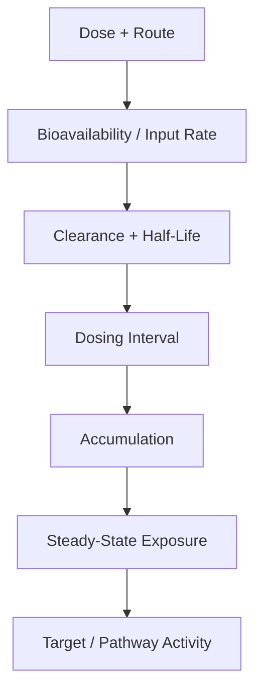

---

## 5. Effective Exposure State / 有效暴露状态

系统中的核心中间对象应为 `EffectiveExposureState`。

The main intermediate object should be `EffectiveExposureState`.

```text
EffectiveExposureState
├── systemic C(t)
├── Cmax / Tmax
├── AUC
├── Cmin
├── Css_avg
├── accumulation ratio
├── free / unbound concentration
├── active-metabolite exposure
├── site-of-action exposure
└── uncertainty
```

这可以统一解释：

This unifies:

- 同剂量不同途径 / same dose, different routes
- 同途径不同制剂 / same route, different formulations
- 相同剂量但不同半衰期 / same dose, different half-lives
- 单次与长期给药 / single vs chronic dosing
- 联用导致的清除率改变 / interaction-modified clearance
- 活性代谢物累积 / active-metabolite accumulation

---

## 6. PK / ADME 模块 / PK / ADME Module

**目的 / Purpose**

计算每个药物及活性代谢物在不同给药方案下的浓度-时间状态。

Compute concentration-time states for each compound and active metabolite under the supplied regimen.

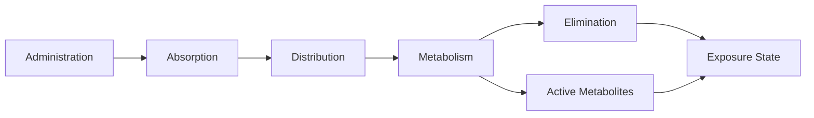

MVP 支持 / MVP support:

- 一室模型 / one-compartment model
- 一阶吸收 / first-order absorption
- IV bolus
- IV infusion
- 重复给药 / repeated dosing
- 稳态计算 / steady-state calculation
- 基础活性代谢物 / basic active metabolites

后续扩展 / Future:

- two-/multi-compartment models
- nonlinear clearance
- saturable metabolism
- PBPK adapters

---

## 7. PK 药物交互 / PK Drug-Drug Interactions

PK 交互模块只负责修改其他药物的暴露状态。

The PK interaction layer is responsible only for modifying another compound's exposure state.

类型 / Classes:

```text
absorption interaction
distribution interaction
enzyme inhibition
enzyme induction
metabolic competition
transporter interaction
renal elimination interaction
protein-binding interaction
```

示例 / Example:

```text
Drug B
  ↓ inhibits
Enzyme X
  ↓
Drug A clearance ↓
  ↓
Drug A half-life ↑
  ↓
AUC / trough / accumulation ↑
```

这意味着联用效应不能只分析首次给药，还必须重新计算长期稳态。

Therefore, combination analysis must not stop at first-dose exposure; long-term steady state must be recomputed after interaction-modified PK parameters are applied.

---

## 8. PD / 靶点与机制模块 / PD / Target and Mechanism Module

**目的 / Purpose**

将有效暴露转换成靶点活性和通路状态。

Convert effective exposure into target activity and pathway states.

支持模型 / Supported model families:

```text
target occupancy
Emax
Hill response
agonism
partial agonism
antagonism
competitive binding
enzyme inhibition
gene-regulatory effects
pathway propagation
```

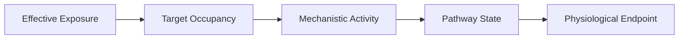

---

## 9. 生理终点模块 / Physiological Endpoint Module

**目的 / Purpose**

将多个通路对同一生理变量的影响进行汇聚。

Aggregate multiple pathway effects onto shared physiological endpoints.

```text
Drug A -> Target A -> Pathway X ┐
                                ├-> Endpoint Y
Drug B -> Target B -> Pathway Z ┘
```

这允许系统识别没有直接 PK 交互、但在系统层面存在 PD 累积的组合。

This allows the engine to detect combinations with little or no PK interaction but meaningful downstream PD convergence.

---

## 10. 单药模拟 / Monotherapy Simulation

每个输入药物必须独立运行一次完整模拟。

Every supplied compound must run through the full kernel independently.

```text
Sim(S0, Drug A)
Sim(S0, Drug B)
Sim(S0, Drug C)
```

每个单药报告输出：

Each monotherapy report includes:

```text
administration profile
exposure-time profile
steady-state state when applicable
active metabolites
mechanisms
expected physiological effects
expected adverse effects
evidence
uncertainty
```

---

## 11. 联用模拟 / Combination Simulation

联用不是“把单药结果相加”，而是从给药事件开始重新运行整个系统。

Combination simulation is not a sum of monotherapy outputs. The complete system is re-run from the administration-event layer.

```text
Sim(S0, Drug A + Drug B + Drug C)
```

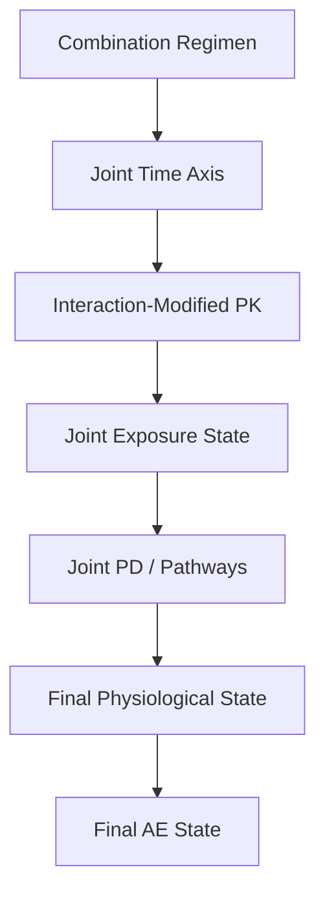

这样才能捕获：

This is necessary to capture:

- 半衰期变化 / half-life changes
- 稳态水平变化 / steady-state changes
- Cmax/Cmin 改变 / peak/trough changes
- 活性代谢物累积 / metabolite accumulation
- 靶点竞争 / target competition
- 不同时间窗的交互 / time-window-dependent interaction
- 停药后的残余效应 / post-discontinuation residual effects

---

## 12. 单药 vs 联用比较 / Monotherapy vs Combination Comparison

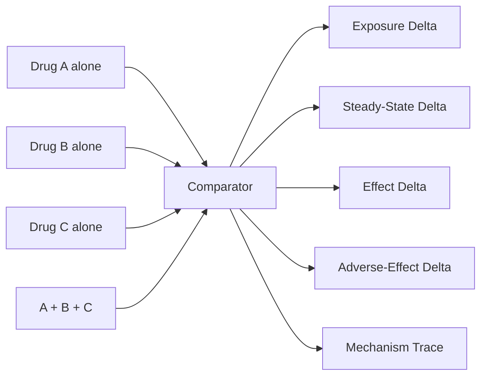

报告应明确回答：

The report should explicitly answer:

- 哪种药物的暴露发生变化？ / Which compound's exposure changed?
- Cmax、AUC、trough、Css 如何变化？ / How did Cmax, AUC, trough, and Css change?
- 半衰期或清除率是否改变？ / Did half-life or clearance change?
- 是 PK、PD 还是耦合交互？ / Was the interaction PK, PD, or coupled?
- 哪些副作用来自单药？ / Which AEs were inherited from monotherapy?
- 哪些副作用由联用放大或新产生？ / Which AEs were amplified or emerged only in combination?

---

## 13. 副作用模块 / Adverse-Effect Module

组合副作用不是多个说明书副作用列表的并集。

The combination AE profile is not the union of monotherapy side-effect lists.

分类 / Classification:

| 类型 / Type | 含义 / Meaning |
|---|---|
| `inherited` | 单药已存在 / present in monotherapy |
| `exposure_amplified` | 因暴露升高而增强 / intensified by increased exposure |
| `shared_endpoint_additive` | 多个药物作用于同一生理终点 / shared physiological endpoint |
| `mechanistic_synergy` | 超出指定非交互基线 / exceeds selected noninteraction baseline |
| `antagonized` | 被另一药物机制削弱 / reduced by another mechanism |
| `emergent` | 主要在组合状态出现 / primarily emerges in combination |
| `uncertain` | 有机制可能但证据不足 / mechanistically plausible, weak evidence |

---

## 14. 急性疗程与长期维持 / Acute Course vs Chronic Maintenance

两种情况应该使用相同内核，但采用不同的时间目标和结果指标。

Both should use the same kernel, but with different time horizons and reporting priorities.

### Acute / finite-course

重点 / Focus:

```text
first-dose exposure
peak concentration
time-to-effect
short-term accumulation
course-end exposure
acute interaction window
washout after final dose
```

适用于 / Suitable for:

- 单次给药 / single administration
- 数日疗程 / multi-day finite courses
- loading sequence
- 短时联用 / temporary coadministration

### Chronic maintenance

重点 / Focus:

```text
steady-state Cmax
steady-state trough
Css_avg
accumulation ratio
time-to-steady-state
chronic metabolite accumulation
persistent enzyme induction/inhibition
long-term pathway adaptation
withdrawal / washout state
```

长期方案必须允许模拟：

Chronic regimens should allow:

- 进入稳态 / approach to steady state
- 稳态期间 / steady-state maintenance
- 改剂量 / dose adjustment
- 加入或移除第二药物 / addition or withdrawal of co-medication
- 停药后的恢复 / post-discontinuation recovery

---

## 15. 时间依赖性交互 / Time-Dependent Interactions

某些交互不是瞬时发生。

Some interactions are not instantaneous.

例如 / Examples:

```text
competitive inhibition
  -> fast onset / fast offset

enzyme induction
  -> delayed onset / delayed offset

mechanism-based inhibition
  -> effect persists until enzyme turnover

long-half-life compound
  -> prolonged residual exposure

active metabolite
  -> delayed or extended pharmacological effect
```

因此 interaction edge 需要包含：

Each interaction edge therefore needs:

```text
onset
offset
time constant
reversibility
dose/exposure dependency
evidence
```

---

## 16. Evidence Knowledge Base / 药理证据知识库

系统使用结构化证据图，而不是让 LLM 自由生成药理结论。

The simulator relies on a structured evidence graph rather than unconstrained LLM-generated pharmacology.

节点 / Nodes:

```text
Compound
Metabolite
Enzyme
Transporter
Target
Gene Regulator
Pathway
Physiological Endpoint
Adverse-Effect Endpoint
```

边 / Edges:

```text
substrate_of
metabolized_by
inhibits
induces
transported_by
agonizes
antagonizes
activates
suppresses
increases
decreases
converges_on
associated_with
```

每条关键边应包含：

Each important edge should include:

```text
magnitude
dose range
exposure range
route
time dependence
population
source
confidence
```

---

## 17. Evidence Governance / 证据治理

推荐证据等级：

Suggested evidence tiers:

```text
Tier 1
direct human DDI / quantified regulatory evidence

Tier 2
human PK/PD / validated population PK / controlled clinical study

Tier 3
observational human / validated pharmacogenomic evidence

Tier 4
in-vitro / animal mechanistic evidence

Tier 5
mechanistic or computational inference
```

系统状态 / Simulation status:

```text
PASS
RESEARCH_ONLY
MECHANISTIC_INFERENCE_ONLY
HOLD_FOR_REVIEW
INSUFFICIENT_EVIDENCE
INVALID_INPUT
```

缺少直接联用研究不等于“无交互”。

Lack of direct combination evidence must never be reported as “no interaction.”

---

## 18. 不确定性 / Uncertainty

至少分为三类：

At least three uncertainty classes should be modeled:

```text
parameter uncertainty
structural/model uncertainty
evidence uncertainty
```

推荐使用：

Recommended approach:

- parameter ranges
- distributions where justified
- Monte Carlo propagation
- confidence intervals
- sensitivity analysis
- dominant uncertainty drivers

---

## 19. LLM 的角色 / Role of LLMs

LLM 可用于：

LLMs may assist with:

- 证据检索 / source discovery
- 文献结构化抽取 / structured extraction
- 同义词解析 / synonym resolution
- 机制图候选生成 / mechanism-graph proposals
- 结果解释 / explanation

LLM 不可：

LLMs must not:

- 发明 PK/PD 参数 / invent PK/PD parameters
- 覆盖治理门 / override governance gates
- 把缺失证据变成精确数值 / turn missing evidence into false precision
- 自动判断组合“安全” / declare a regimen safe
- 推荐药物或方案 / recommend a drug or regimen

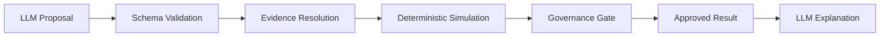

---

## 20. 模块结构 / Module Map

```text
drug-simulator/
├── contracts/
│   ├── physiology
│   ├── regimen
│   ├── exposure
│   ├── mechanism
│   ├── endpoint
│   └── evidence
│
├── canonicalization/
│   ├── compound
│   ├── route
│   ├── formulation
│   └── units
│
├── knowledge/
│   ├── compound registry
│   ├── PK/PD parameter store
│   ├── mechanism graph
│   └── evidence registry
│
├── timeline/
│   ├── dose events
│   ├── regimen modes
│   └── treatment horizon
│
├── simulation/
│   ├── administration
│   ├── PK
│   ├── exposure
│   ├── PK-DDI
│   ├── PD
│   ├── pathways
│   ├── physiology
│   └── adverse effects
│
├── uncertainty/
├── governance/
├── reporting/
├── api/
└── cli/
```

---

## 21. 推荐 MVP / Recommended MVP

第一版优先验证机制覆盖，而不是药物数量。

The first version should optimize for mechanistic coverage rather than database size.

### Compounds

10–20 个机制差异明显、公开证据充分的化合物。

10–20 compounds with diverse mechanisms and strong public evidence.

覆盖 / Cover:

- CYP substrate
- CYP inhibitor
- CYP inducer
- transporter interaction
- active metabolite
- renal-clearance-sensitive compound
- agonist
- antagonist
- partial agonist
- route-sensitive compound
- long-half-life compound
- depot / slow-release case

### Routes

```text
oral
IV bolus
IV infusion
SC
IM
transdermal
```

### Regimen modes

```text
single_dose
acute_course
chronic_maintenance
loading_plus_maintenance
intermittent
taper
```

### PK

```text
one-compartment oral
IV bolus
IV infusion
repeated dosing
steady-state
active metabolite
```

### PD

```text
occupancy
Emax
Hill
target competition
pathway convergence
```

---

## 22. 推荐演示场景 / Recommended Demo Scenarios

### A. 同剂量，不同途径 / Same Dose, Different Route

```text
same nominal dose
→ different exposure
→ different downstream effect
```

### B. PK 交互 / PK Interaction

```text
same administered dose
→ clearance changes
→ half-life changes
→ steady-state exposure changes
```

### C. PD 汇聚 / PD Convergence

```text
no major PK change
→ shared physiological endpoint changes
```

### D. 长期稳态联用 / Chronic Steady-State Interaction

```text
Drug A reaches steady state
→ Drug B is introduced
→ A clearance changes
→ new steady state emerges
```

### E. 短期疗程 / Acute Course

```text
finite dosing window
→ peak interaction
→ course-end state
→ washout
```

### F. Failure-Closed

```text
critical physiology or route missing
→ HOLD_FOR_REVIEW
```

---

## 23. 与 Research OS 的关系 / Relationship to Research OS

Drug Simulator 可作为 Research OS 下的第二个领域内核。

Drug Simulator can serve as a second domain kernel under the Research OS architecture.

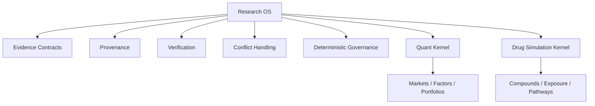

共享层负责：

The shared layer owns:

- evidence contracts
- provenance
- conflict preservation
- reproducibility
- deterministic governance
- audit artifacts

领域内核只负责各自的计算模型。

Each domain kernel owns only its domain-specific computational model.

---

## 24. 输出原则 / Output Principles

最终输出不应是单个“药效分数”。

The final output should never collapse into one opaque “drug effect score.”

它应回答：

It should answer:

```text
What was administered?
What exposure resulted over time?
Was steady state reached?
How did the route change exposure?
How did half-life affect accumulation?
Which PK parameters changed in combination?
Which targets and pathways changed?
Which physiological effects changed?
Which adverse effects were inherited, amplified, or emergent?
Which conclusions are directly evidenced?
Which are mechanistic inference?
How uncertain is the result?
What critical information is missing?
```

---

## 25. 桌面版可视化规范 / Desktop Visualization Grammar

Drug Simulator 的桌面应用应使用一致的视觉语义，使用户能够在不重新学习图例的情况下跨页面理解药物、时间状态、模拟性质与不确定性。

The desktop application should use a consistent visual grammar so users can interpret compound identity, temporal state, simulation status, and uncertainty across views without relearning the legend.

### 25.1 颜色表示药物身份 / Color Encodes Compound Identity

每个药物在整个应用中应保持固定主色。

Each compound should retain one stable primary color throughout the application.

```text
Drug A -> Color A
Drug B -> Color B
Drug C -> Color C
```

同一药物的活性代谢物优先使用同色系的次级色，而不是分配完全无关的新颜色。

Active metabolites should preferably use a related secondary shade of the parent compound instead of an unrelated color.

颜色只表达“是哪一种药物”，不同时承担风险等级或时间状态。

Color should encode only compound identity, not risk level or temporal status.

---

### 25.2 历史与未来 / Historical vs Future State

时间性质使用线型和节点样式编码：

Temporal status is encoded using line and marker styles:

| 状态 / State | 样式 / Style |
|---|---|
| 历史记录、已发生状态 / historical or realized state | 实线 + 实心点 / solid line + filled markers |
| 未来预测、假设状态 / future simulated or hypothetical state | 虚线 + 空心点 / dashed line + hollow markers |
| 备选方案 / alternative what-if branch | 点划线或次级虚线 / dash-dot or secondary dashed line |
| 参考值 / reference | 细参考线或背景带 / thin reference line or background band |

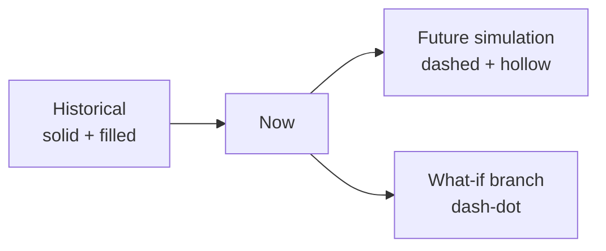

这一规则适用于：

This convention applies to:

- 血药浓度-时间曲线 / concentration-time plots
- 生理终点趋势 / physiological endpoint trends
- 稳态变化 / steady-state transitions
- 药物加入或移除后的新稳态 / post-addition or post-withdrawal steady states
- 停药后的 washout / post-discontinuation washout

---

### 25.3 不确定性 / Uncertainty

未来模拟不能只显示一条预测线。

Future simulation should not be represented by a single deterministic curve alone.

推荐使用：

Recommended:

```text
median / central estimate -> dashed line
uncertainty interval      -> shaded band
```

阴影带表示参数、结构和证据不确定性的综合结果。

The shaded interval represents propagated parameter, structural, and evidence uncertainty.

透明度用于表达不确定区间，不用于编码药物身份。

Opacity should encode uncertainty intervals rather than compound identity.

---

### 25.4 给药与方案事件 / Administration and Regimen Events

关键方案变化应作为时间轴事件显式绘制。

Important regimen changes should be explicitly shown as timeline events.

事件包括：

Events include:

- 开始给药 / drug start
- 停止给药 / discontinuation
- 改变剂量 / dose change
- 改变给药间隔 / interval change
- 改变给药途径或制剂 / route or formulation change
- 加入第二药物 / add-on compound
- 移除联用药物 / co-medication withdrawal
- loading dose / maintenance transition

推荐使用垂直事件线并附简短标签。

Use vertical event markers with concise labels.

```text
        Add Drug B
            │
            ▼
────────────│──────────────────── time
     Drug A steady state
            │
            └── new interaction-modified trajectory
```

---

### 25.5 治疗窗、阈值与目标区间 / Windows, Thresholds, and Target Ranges

参考区间应与药物轨迹使用不同视觉语义。

Reference ranges should use a different visual grammar from compound trajectories.

推荐：

Recommended:

- 治疗窗 / therapeutic window -> background band
- 风险阈值 / risk threshold -> horizontal reference line
- 目标稳态区间 / target steady-state range -> background band
- 模型边界 / model-validity boundary -> neutral dashed reference line

这些参考元素不使用药物主色，以避免与药物身份混淆。

Reference elements should not reuse compound identity colors.

---

### 25.6 血药水平图 / Concentration-Time Plot

血药浓度图是桌面应用的核心可视化之一。

The concentration-time plot is one of the primary desktop visualizations.

应至少包含：

It should support:

```text
compound-specific colors
historical solid segments
future dashed segments
filled historical dose markers
hollow future dose markers
Cmax
Cmin / trough
AUC context
steady-state region
uncertainty band
dose/add/stop event markers
therapeutic or risk reference bands when evidence exists
```

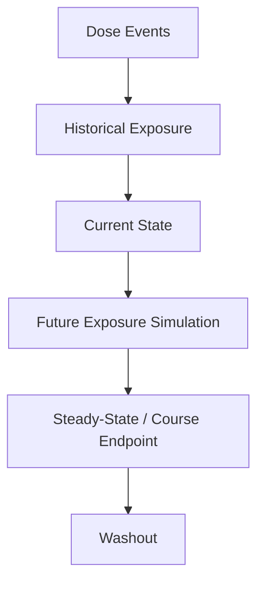

---

### 25.7 多药显示 / Multi-Drug Display

当药物数量较少时可叠加显示。

For a small number of compounds, trajectories may be overlaid.

当药物数量增加时，应避免一张图塞入所有轨迹。

When the compound count increases, the interface should avoid overloading one plot.

推荐策略：

Recommended strategies:

- 默认显示 1–3 个选中药物 / show 1–3 selected compounds by default
- 支持 compound visibility toggle
- 提供 small multiples / per-drug mini-plots
- 支持“只看母药 / 包含代谢物”
- 支持“只看当前选中交互链”

避免仅靠颜色区分大量曲线。

Do not rely on color alone to distinguish many simultaneous trajectories.

---

### 25.8 稳态迁移视图 / Steady-State Transition View

长期维持方案应提供专门的稳态迁移视图。

Chronic-maintenance scenarios should provide a dedicated steady-state transition view.

示例：

Example:

```text
Drug A reaches steady state
        ↓
Drug B introduced
        ↓
A clearance changes
        ↓
A half-life changes
        ↓
new Cmax_ss / Cmin_ss / Css_avg
        ↓
new physiological state
```

该图应清楚区分：

The visualization should distinguish:

- 旧稳态 / previous steady state
- 交互过渡期 / interaction transition
- 新稳态 / new steady state
- 停药恢复期 / post-withdrawal recovery

---

### 25.9 副作用贡献图 / Adverse-Effect Contribution View

副作用可视化应体现“来源”和“交互原因”，而不只是显示严重程度。

Adverse-effect visualization should expose contribution and interaction mechanism, not severity alone.

可显示：

Possible dimensions:

```text
Drug A contribution
Drug B contribution
PK-mediated amplification
PD shared-endpoint contribution
uncertainty
```

颜色继续表示药物身份；副作用风险等级使用独立图标、标签或轴值。

Color continues to represent compound identity; risk level should use independent symbols, labels, or numeric axes.

---

### 25.10 交互机制图 / Interaction Mechanism View

机制图应用固定节点与边语义。

Mechanism graphs should use stable node and edge semantics.

```text
Compound
  -> Enzyme / Transporter
  -> Exposure change
  -> Target
  -> Pathway
  -> Physiological endpoint
  -> Effect / AE
```

建议：

Recommended:

- 药物节点使用药物身份色 / compound nodes use compound identity colors
- 酶、转运体、靶点、通路使用中性色或类型色 / enzymes, transporters, targets, and pathways use neutral/type-specific styling
- 激活与抑制使用不同箭头语义 / activation and inhibition use distinct edge semantics
- 未来假设机制边使用虚线 / future or hypothetical mechanism edges use dashed styling
- 低置信机制使用更弱透明度并附 evidence badge / low-confidence edges use reduced emphasis plus an evidence badge

---

### 25.11 无障碍与主题 / Accessibility and Theme

可视化必须同时适用于：

Visualizations should work in:

- 浅色模式 / light mode
- 深色模式 / dark mode
- 色弱场景 / color-vision deficiency
- 截图与灰度打印 / screenshots and grayscale printing

因此必须采用双重编码：

Use redundant encoding:

```text
compound identity -> color
time/status       -> line + marker style
uncertainty       -> shaded band
events            -> vertical markers
risk/reference    -> labels / bands / threshold lines
```

任何关键语义都不能只依赖颜色。

No critical semantic distinction should depend on color alone.

---

## 26. 开发文档 / Development Specification

详细工程逻辑、数据契约、PK/PD 模型、交互解析、时间轴与稳态计算、证据治理、可视化契约、测试策略和分阶段实现计划见：

For implementation contracts, PK/PD models, interaction resolution, timeline and steady-state simulation, evidence governance, visualization contracts, testing strategy, and development phases, see:

[`idea-structure.md`](./idea-structure.md)

---

## 27. 当前阶段 / Current Stage

**状态：研究模拟器设计基线，尚未实现。 / Status: research-simulator design baseline, not yet implemented.**

当前仓库提供产品理念、系统边界、PK/PD 与交互建模路线、证据治理、可视化语义和分阶段开发计划。它可以作为架构讨论、知识库设计、fixture 选择和 MVP 开发的起点，但不代表已有药理数据库、已校准模型、临床验证或可用于决策的应用。

The repository provides a product thesis, system boundaries, PK/PD and interaction modeling strategy, evidence governance, visualization semantics, and staged development plan. It is a development starting point—not an implemented pharmacology database, calibrated clinical model, validated medical product, or decision system.

| Area | Design state | Initial development target |
|---|---|---|
| Regimen and timeline | Contract drafted | deterministic dose-event timeline |
| PK exposure | Model hierarchy drafted | one-compartment oral and IV fixtures |
| Interaction resolver | Mechanism classes drafted | one quantified PK DDI case |
| PD and endpoints | Core equations drafted | one occupancy/Emax fixture |
| Evidence governance | Tier and status model drafted | source-linked records with conflicts |
| Desktop visualization | Visual grammar drafted | view-model JSON, not a full UI |

---

## 28. 目标用户 / Intended Users

Drug Simulator 面向：

- 研究 PK/PD、给药时间轴和机制交互的工程或计算研究人员；
- 需要证据可追溯、缺失信息可见的模拟原型团队；
- 探索知识图谱、数值模型和治理门如何协同的学生与开发者；
- 需要生成可审计研究报告，而不是单一“药效分数”的工具设计者。

It is not intended for:

```text
diagnosis
prescribing
dose recommendation
patient-specific treatment selection
automatic safety clearance
replacement of regulatory or clinical review
```

真实患者输入、个人健康数据和未授权医学数据不属于初始 MVP。

---

## 29. 初始开发路径 / Initial Development Path

第一阶段应优先证明“模型与证据边界可执行”，而不是快速增加药物数量。

1. **Contracts and evidence** — 固化生理基线、给药方案、化合物、证据与结果契约；只收录可溯源参数。
2. **Exposure timeline** — 用合成 fixture 实现 oral、IV、重复给药、半衰期、累积和稳态。
3. **Interaction slice** — 选择一个有直接量化证据的 PK DDI 示例，实现旧稳态到新稳态的变化。
4. **PD and attribution** — 加入一个 target/endpoint 示例，区分 PK 放大、PD 汇聚与不确定归因。
5. **Governed report** — 输出单药 vs 联用、证据覆盖、缺失参数、敏感性和 fail-closed 状态。

每一步必须同时交付：

```text
source-linked parameters
machine-readable fixture
expected numerical behavior
tests and tolerances
uncertainty/limitations
human-readable explanation
```

---

## 30. 推荐首批演示 / Recommended First Demonstrations

首个可评审版本只需要少量但机制差异清晰的场景：

| Scenario | What it proves | What it does not prove |
|---|---|---|
| Same dose, oral vs IV | route changes exposure mechanics | clinical interchangeability |
| Repeated oral dosing | accumulation and steady-state math | patient-specific prediction |
| Add quantified inhibitor | time-dependent PK interaction | safety of a drug combination |
| Shared PD endpoint | PD convergence without PK change | real adverse-event probability |
| Missing critical parameter | fail-closed governance | absence of interaction |

公开演示数据优先使用合成参数或许可清楚、可引用的公开来源，并在界面和报告中明确标记。

---

## 31. 证据与声明边界 / Evidence and Claim Boundaries

- 参数必须记录单位、适用人群、给药途径、来源、版本和不确定性。
- 体外、动物、观察性与人体 DDI 证据不得静默合并为同一强度。
- 缺少直接研究只能输出 `INSUFFICIENT_EVIDENCE`、`MECHANISTIC_INFERENCE_ONLY` 或 `HOLD_FOR_REVIEW`，不能输出“无交互”。
- 模型拟合成功不代表生理机制正确；数值稳定不代表临床有效。
- LLM 只协助检索、抽取和解释，不能生成未经证据解析的参数或绕过治理门。

The project should make the path from source evidence to parameter, mechanism, simulation state, uncertainty, and report claim inspectable end to end.

---

## 32. 版本与可复现性 / Versioning and Reproducibility

每次可比较模拟应固定：

```text
simulator version
contract version
compound profile version
evidence snapshot
physiology profile version
regimen input hash
solver configuration
random seed if used
report schema version
```

知识库更新不得静默改变历史运行。旧运行应继续指向当时的 evidence snapshot，并允许在新版本下显式重算和比较。

---

## 33. 参与设计 / Contributing to the Design

新增模型、参数或药物条目之前，请回答：

1. 数据来源和许可是什么？
2. 参数适用于什么人群、途径、剂量和时间范围？
3. 不确定性与冲突证据如何保存？
4. 该能力改变哪些输出，又明确不能支持哪些结论？
5. 如何用单元、性质、回归或敏感性测试验证？

详细 backlog、验收矩阵、数据准入规则与启动清单见 [`idea-structure.md`](./idea-structure.md)。

---

## 34. 医学与工程加固包 / Medical and Engineering Hardening Pack

本归档新增了一组可直接约束实现的补充材料：

- [`docs/medical-and-pharmacology-gap-analysis.md`](./docs/medical-and-pharmacology-gap-analysis.md)：审查适用人群、制剂、特殊场景、非线性/时变机制、临床结局边界和声明用语。
- [`docs/software-architecture-and-module-contracts.md`](./docs/software-architecture-and-module-contracts.md)：定义纯科学内核、端口/适配器、不可变工件、模块状态和依赖禁区。
- [`docs/verification-and-cross-validation-plan.md`](./docs/verification-and-cross-validation-plan.md)：定义解析 oracle、独立实现、变形测试、外部验证和 `NOT_RUN` 边界。
- [`contracts/`](./contracts/)：提供模块结果、模型适用域和验证包的 JSON Schema 起点。
- [`examples/synthetic/`](./examples/synthetic/)：只包含明确标记的合成契约示例，不代表真实药物或患者。

这些材料将“模块解耦”和“交叉验证”从建议提升为发布约束。当前仍是设计基线；新增 schema 通过结构验收不等于药理、医学或临床验证。

---

## 35. 零数据外传 / Zero-Data-Egress Local Processing

严格隐私模式采用两条完全分离的数据平面：联网获取区只能按照固定公共清单拉取公开资料，不能读取病例、方案或模拟结果；本地敏感区可以执行证据匹配、PK/PD、DDI、本地 AI 与报告，但全部组件默认禁网。

- 设计与威胁模型：[`docs/local-private-data-architecture.md`](./docs/local-private-data-architecture.md)
- 出站策略契约：[`contracts/network-egress-policy.schema.json`](./contracts/network-egress-policy.schema.json)
- 合成严格模式示例：[`examples/synthetic/network-egress-policy.example.json`](./examples/synthetic/network-egress-policy.example.json)

默认禁止把病例内容转写成外部检索词。资料不足时返回 `EVIDENCE_SNAPSHOT_INSUFFICIENT`，由人员更新不含病例语境的公共获取清单；系统不会静默降级到云端检索、外部 LLM、OCR、翻译或遥测服务。

---

## 36. 三层重叠验证森林 / Three-Layer Overlapping Validation Forest

现有阶段被进一步拆成身份、单位、隐私、给药、时间、生理修正、方程构造、耦合组装、数值求解、暴露投影、稳态检测、靶点、状态响应、通路、端点、风险、归因、不确定性、比较、证据覆盖、治理和报告等单一责任模块。

每个阶段结论及最终结论强制具有：

```text
L1 module scientific/numerical validation
L2 adjacent and cross-stage validation
L3 orthogonal independent validation
```

三层必须来自不同独立性域、连接不同证据 anchor，并通过 `OVERLAPS_WITH` 形成连通交互子图。所有阶段树必须接入同一个最终关系森林；循环自证、孤立结论、生产结果生成 expected value、同一 helper 包装成多个验证器均会失败关闭。

- 细粒度模块与验证规则：[`docs/decomposed-modules-and-validation-forest.md`](./docs/decomposed-modules-and-validation-forest.md)
- 森林契约：[`contracts/validation-forest.schema.json`](./contracts/validation-forest.schema.json)
- 合成连通示例：[`examples/synthetic/validation-forest.example.json`](./examples/synthetic/validation-forest.example.json)
